# Alpha Connectome: the challenge and our solution

Written 2026-10-20.
Every figure is drawn from the real data by `src/make_tutorial_figs.py`.
Numbers marked *measured* come from our own runs; numbers marked *dozken* come from a public repo of another competitor and are not reproduced by us.

---

## 0. The problem in one paragraph

Wunder Fund, a high-frequency trading firm, gives us market data as long sequences.
Each sequence has 20,000 rows (moments in time).
Each row has 112 numbers describing the market state of two instruments, `i0` and `i1`.
For every row we must predict two numbers, `t0` and `t1`, which say how the price of `i0` will move next.
The catch: our code sees **one row at a time, in order, and must answer before it sees the next row**.
That is how a live trading system works, and the scorer enforces it.

Dates: started 2026-09-11, final submissions 2026-11-15, winners 2026-12-01.
Prizes: 13,600 USDT for the top 8, with $5,000 for first.

### The data

| file | sequences | rows | has targets | has `is_scored` |
|---|---|---|---|---|
| `train.parquet` | 10,607 | 212,140,000 | yes | **no** |
| `valid.parquet` | 1,873 | 37,460,000 | yes | yes |
| hidden test | 1,970 | 39,400,000 | hidden | hidden |

| column group | count | meaning (as far as the organisers say) |
|---|---|---|
| `i0_p0..p21`, `i1_p0..p21` | 44 | "price-like" features per instrument |
| `i0_v0..v21`, `i1_v0..v21` | 44 | "volume-like" features per instrument |
| `i0_dp0..3`, `i1_dp0..3` | 8 | price changes |
| `i0_dv0..3`, `i1_dv0..3` | 8 | volume changes |
| `a0..a7` | 8 | additional, unexplained |
| `t0`, `t1` | 2 | the targets, for `i0` |

All features are anonymised and already scaled; the index in a name is an identifier, not an order-book depth.

Real rows from valid sequence 0 (7 of 112 features shown):

| step | i0_p0 | i0_p3 | i0_v0 | i0_dp0 | i1_p0 | a3 | a5 | ... | t0 | t1 | is_scored |
|---|---|---|---|---|---|---|---|---|---|---|---|
| 0 | -1.825 | -1.756 | 0.725 | -1.876 | -1.999 | -0.701 | -0.584 | ... | 1.129 | -1.881 | False |
| 98 | -0.988 | -1.120 | 0.734 | -0.530 | -0.988 | -1.093 | -0.685 | ... | 0.000 | -0.125 | False |
| 99 | -0.988 | -1.120 | 0.741 | -0.530 | -0.988 | -1.087 | -0.616 | ... | 0.000 | -0.125 | False |
| 260 | -2.199 | -2.018 | 0.698 | -0.530 | -1.706 | -0.558 | -0.324 | ... | -0.878 | 1.505 | False |
| 261 | -2.199 | -2.018 | 0.613 | -0.699 | -1.330 | -0.565 | -5.199 | ... | -0.878 | 1.505 | True |
| 262 | -2.199 | -2.018 | 0.659 | 0.163 | -1.330 | -0.574 | -5.199 | ... | -0.878 | 1.505 | True |
| 263 | -2.199 | -2.018 | 0.659 | -0.530 | -1.330 | -0.581 | -0.688 | ... | -0.878 | 1.505 | True |
| 264 | -2.199 | -2.018 | 0.706 | -0.530 | -1.330 | -0.575 | -0.537 | ... | -0.878 | 1.505 | False |
| 265 | -2.199 | -2.018 | 0.694 | -0.530 | -1.485 | -0.553 | -0.381 | ... | -0.878 | 1.505 | True |

Rows 0 to 98 are warm-up: the model sees them but is not asked for an answer.
From row 99 on, every row needs two numbers.
Only some rows are actually scored (`is_scored`), and in the test set nobody tells us which.

---

## 1. What one sequence looks like

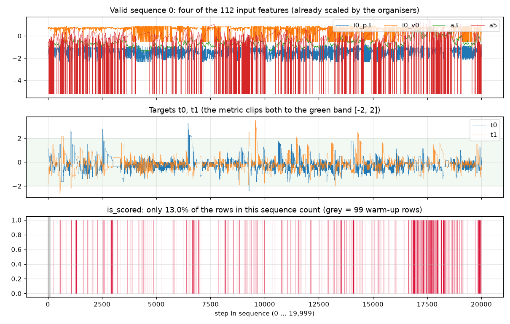

Three things to see here.

1. The targets (middle) move in **steps and plateaus**, not as noise around zero.
2. Only **13.0%** of this sequence's rows are scored (bottom, red).
3. The scored rows are not spread evenly; they cluster (here, near the end).

Zoomed in, the scored rows come in short bursts of 1 to 8 rows:

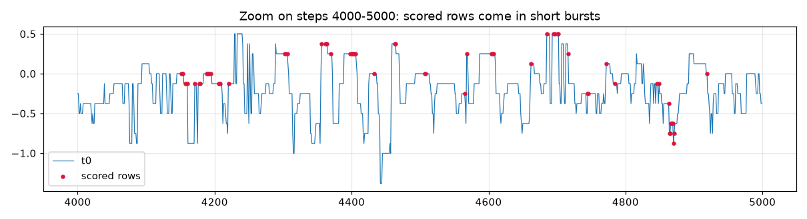

Across valid, the share of scored rows per sequence ranges from 0.7% to 60%, median 7.8% (*measured*, 400 sequences).
The target is very smooth: neighbouring rows are almost the same value, and the memory fades over a few hundred rows.

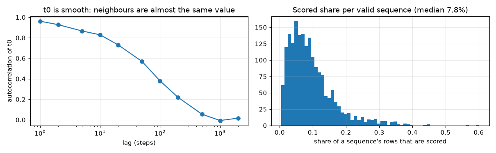

**What this buys us:** a model that remembers recent rows knows most of the answer already.
A model that sees only the current row throws that away.
That is the case for a recurrent model (section 4).

---

## 2. The score, explained by breaking it

The metric is a **weighted Pearson correlation**, computed once per target and averaged:

- clip targets and predictions to [-2, 2];
- weight each row by |target| (so a target of 0 counts for nothing, a target of 2 counts double a target of 1);
- compute one correlation over **all scored rows of all sequences pooled together**.

Three consequences, each shown with a counterexample.

### 2a. A per-sequence offset is pure noise

Take two sequences where the model is equally good.
Shift every prediction in sequence B up by 1.5.
Within each sequence nothing changed, but pooled together the score drops from 0.865 to 0.762:

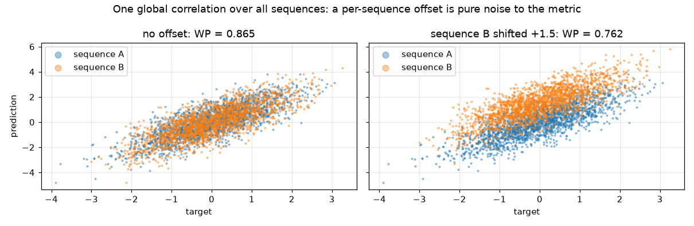

So the model must output the **same level everywhere**: at row 200 and at row 19,000, in a quiet sequence and a busy one.
This is why resetting the state every 2,000 rows helps (section 5c): a model that drifts over 20,000 rows produces exactly this offset.

### 2b. Big targets dominate, zeros are invisible

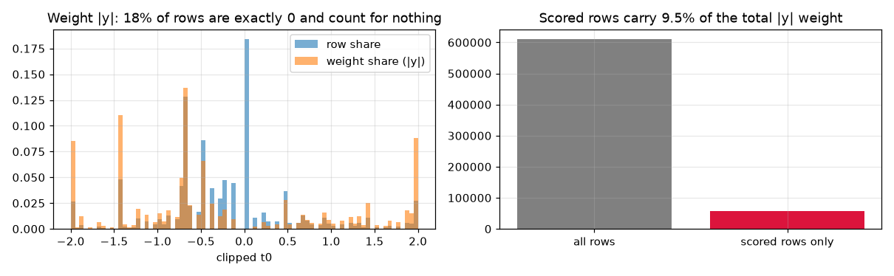

18% of rows have a target of exactly 0 and weight 0.
The rows near ±2 carry most of the weight.
The best prediction under this weighting is not the plain average of what tends to follow; it is that average with large moves counted more heavily.
Training with the same |y| weight in the loss aims at exactly that (our first A/B test, section 7).

### 2c. Predictions above 2 are wasted

The scorer clips predictions to [-2, 2].
Scaling a good model's output up by 1.5× costs 0.004, and by 2× costs 0.018 (*dozken*), because the large predictions get flattened.
So we never rescale outputs after training.

---

## 3. The hard limit: speed

The test set is 39.4 million rows, run through our `predict()` one row at a time, on **one CPU core, in 60 minutes**.

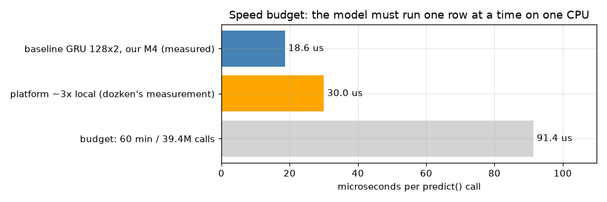

- 60 minutes / 39.4M rows = **91 µs per row**, including Python overhead.
- The scoring server is about 3× slower than a laptop (*dozken*: the same model took 38 to 64 minutes on different days).
- So in practice a model must run in about **30 µs per row on our Mac**.
- The provided baseline takes **18.6 µs** (*measured*, full valid in 698 s).

This rules out anything that re-reads a long history at every row.
A model must carry a small summary of the past forward and update it cheaply.
That summary is the recurrent state.

---

## 4. The model: a GRU

### 4a. The architecture

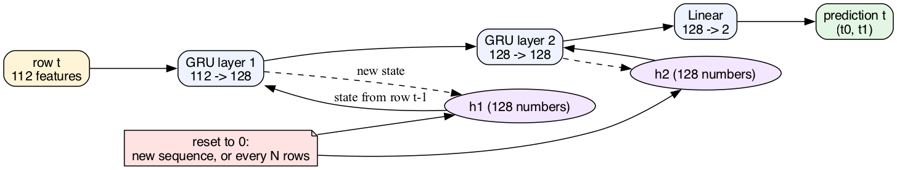

- **Input:** the 112 features of the current row.
- **GRU layer 1:** turns the input plus its own memory `h1` (128 numbers) into a new memory.
- **GRU layer 2:** the same again, on top of layer 1, with memory `h2`.
- **Linear head:** reads layer 2's memory and outputs the two predictions.
- **Reset:** both memories are set to zero at the start of each sequence, and optionally every N rows (section 5c).

Per row this is about 190,000 multiply-adds (3 × 128 × (112 + 128) + 3 × 128 × (128 + 128) + 256), and the cost is the same at row 100 as at row 19,000.

### 4b. What a GRU cell does, from the simplest case

Start with the simplest memory: an exponential average.

```
h_t = (1 − z) · h_{t−1} + z · x_t
```

With a fixed z = 0.1 the memory forgets slowly; with z = 0.9 it nearly copies the new input.
The problem: the right forgetting speed depends on the moment (quiet market versus a jump).

A GRU learns z from the data, row by row:

```
z_t = sigmoid(W_z x_t + U_z h_{t−1})            the "update gate": how much to change the memory now
r_t = sigmoid(W_r x_t + U_r h_{t−1})            the "reset gate": how much of the old memory to use
ĥ_t = tanh(W x_t + U (r_t ⊙ h_{t−1}))           the candidate new memory
h_t = (1 − z_t) ⊙ h_{t−1} + z_t ⊙ ĥ_t           blend old and new
```

That is the exponential average with a forgetting speed that the market state chooses, separately for each of the 128 memory slots.

### 4c. Why not a transformer

A transformer looks back over a window of past rows at every step.
At one row per call, it must store that window and attend over it every time, so its cost grows with the window.
A GRU's cost is fixed.
We have not tested a transformer; a small one with a capped window might fit the budget, and it is a possible later experiment.

---

## 5. The solution, step by step

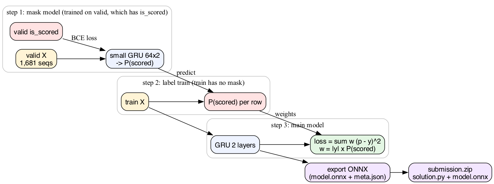

### 5a. Step 1: learn where the scoring happens (mask model)

**The problem it solves.**
The test scores only about 9% of rows, and nobody tells our code which ones.
The training file does not say either.
Only the valid file has the `is_scored` column.
If the main model treats every row as equally important, it spends most of its effort on rows that never count.

**What a mask model is.**
A second, small model whose only job is to answer one yes/no question per row: *is this row likely to be scored?*
It outputs a probability, P(scored), between 0 and 1.
It never predicts the targets; it only says where to look.

**How it works.**

1. Input: the same 112 features, one row at a time, in order: the same causal setting as the main model.
2. Model: a small GRU (2 layers, 64 numbers of memory each) plus one output number, turned into a probability by a sigmoid.
3. Labels: `is_scored` from valid sequences 192 to 1,872 (1,681 sequences, 33.6M rows).
4. Loss: binary cross-entropy, the standard loss for yes/no questions; it punishes a confident wrong answer hardest.
5. Imbalance: only about 1 row in 10 is a "yes", so a model that always says "no" is 90% right and useless.
   We weight each "yes" row 9.15 times (`pos_weight` = non-scored / scored), so both classes count equally in the loss.
6. Held out: valid sequences 0 to 191 are never trained on; every number below is measured on them.

Here it is running on a held-out sequence it has never seen (red = truly scored, black = the model's P):

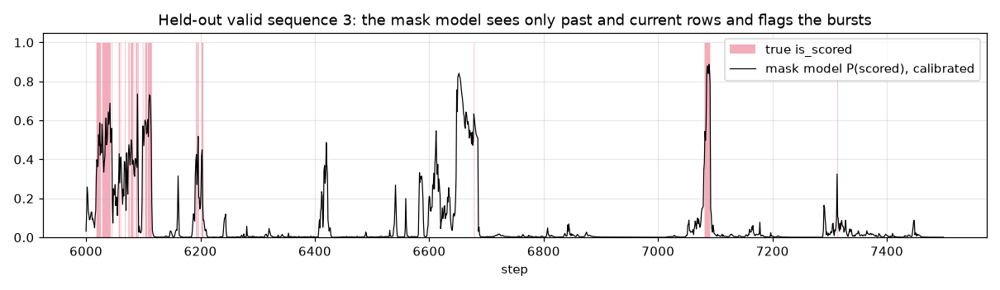

It rises on the bursts and stays near zero between them, and it does so using only rows up to the current one.
It also has false alarms (around step 6650): moments that look like scored moments but were not.

**Why it can work at all.**
Scored rows are not random.
Two facts, measured on valid:

- Bursts are sticky: if a row is scored, the next row is scored with probability 0.743; if not, only 0.024.
  So recent history (the GRU's memory) is very informative.
- A few features shift strongly on scored rows; `a3` most of all (0.82 standard deviations higher), then `a2` and `a4`:

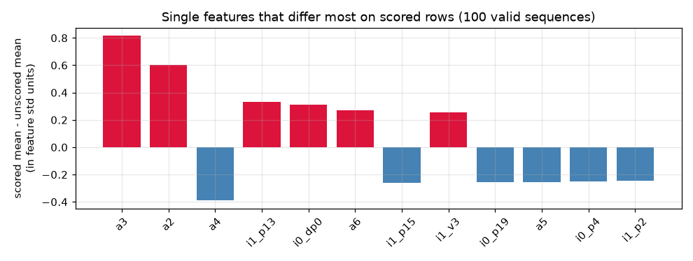

**How good is it?**

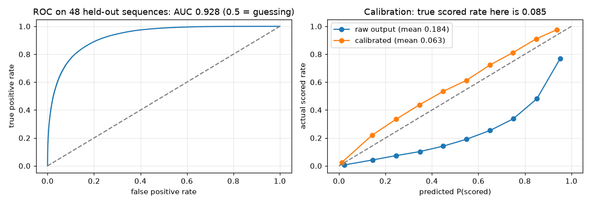

- Left: AUC 0.928 on 48 held-out sequences (0.933 on all 192). AUC is the chance that a random scored row gets a higher P than a random unscored row; 0.5 is guessing, 1.0 is perfect. dozken reached 0.94.
- Right, a counterexample worth knowing: the raw output says P = 0.184 on average, but only 8.5% of rows are scored.
  That is not a bug in the model, it is the `pos_weight` trick: by counting every "yes" 9 times, we taught the model that "yes" is 9 times more common than it is.
- The fix is to divide the odds P / (1 − P) by the same 9.15.
  The orange curve shows the result: much closer to the diagonal, but it now *under*-predicts (mean 0.063 against 0.085).
  The simple correction overshoots; fitting the correction on held-out data (Platt or isotonic scaling) would land on the diagonal.
  This is an open item; it changes the size of the weights, not their order.

**How it is used.**
The mask model runs once over the training file, offline, and writes P(scored) for every row.
It is **not** part of the submission and costs nothing at scoring time.
The main model's loss then weights each row by |y| × P(scored) (step 2).

### 5b. Step 2: label train and weight the loss

The mask model writes P(scored) for every training row.
The main model's loss then counts each row by

```
weight = |y| × P(scored)
```

so the model spends its capacity where the metric looks: on big moves in moments that are likely to be scored.
Valid sequences 192 onward join the training data with their true mask; sequences 0 to 191 are held out for every evaluation.

### 5c. Step 3: train the GRU the way it will be used

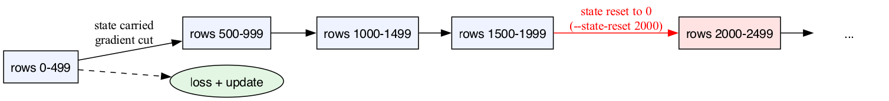

A batch is several whole 20,000-row sequences.
We walk through them 500 rows at a time:

- the memory is **carried** from one chunk to the next, as at inference;
- the gradient is **cut** at each chunk boundary, so memory use stays small (this is "truncated backpropagation through time");
- the memory is **reset to zero every 2,000 rows** (`--state-reset 2000`), in training and at inference alike.

Why reset?
dozken measured that the model's memory degrades over a long sequence: setting it to zero halfway through a sequence *improved* the second half.
A reset every 2,000 rows keeps the model in conditions it knows, and gives a consistent output level across the sequence, which the global metric rewards (section 2a).
Their best single model used exactly this.

### 5d. Step 4: export and submit

The trained model is exported to ONNX, a standard file format for neural networks.
The submission is a ZIP with `solution.py`, `model.onnx` and `meta.json`.
`solution.py` keeps the two memories between calls, resets them on a new sequence or every N rows, and runs one row through ONNX Runtime per call.

---

## 6. PyTorch or from scratch?

| part | built with | who wrote it |
|---|---|---|
| data conversion to fast float16 arrays (`src/prep.py`) | numpy, pyarrow | us |
| GRU cell maths and its GPU kernel | **PyTorch `nn.GRU`** | PyTorch |
| model wiring, loss, masking, resets, training loop, checkpoints (`src/train_gru.py`) | PyTorch | us |
| mask model (`src/mask_model.py`) | PyTorch | us |
| held-out scorer (`src/score_holdout.py`) | numpy + the organisers' `weighted_pearson` | us + organisers |
| inference at scoring time (`src/solution.py`) | **ONNX Runtime**, no PyTorch | us |
| baseline model | ONNX file only, no training code | organisers |

So: the GRU cell itself is PyTorch's, because its kernels are fast and well tested, and writing our own would buy nothing.
Everything around it is our own: how sequences are fed, how state is carried and reset, what the loss weights, and how the mask is learned.
At scoring time PyTorch is not used at all: ONNX Runtime runs the exported graph.

Checked (*measured*): the ONNX model run row by row in `solution.py` gives the same predictions as the PyTorch model run on whole sequences, to within 3.6e-7, with and without resets.

---

## 7. Where we stand (2026-10-20, 21:10)

| model | held-out valid 0–191 | full valid | public board |
|---|---|---|---|
| provided baseline GRU 128×2 | **0.61987** (*measured*) | **0.617052** (*measured*, equals organisers' figure) | **0.59353** (2026-10-20, 26m36s on the platform) |
| GRU, plain MSE, 600 train seqs | 0.64906 (epoch 4) | — | 0.61346 |
| GRU, \|y\|-weighted MSE, 600 train seqs | 0.66197 (epoch 4) | — | **0.63279** |
| GRU, \|y\| × P(scored) soft mask, 600 train seqs | 0.67231 (epoch 4) | — | 0.63693 |
| GRU + soft mask + valid + reset 2000 | next | — | — |
| GRU soft mask, full training set (Colab L4, 4 epochs) | 0.68310 | — | **0.65392** |

For scale: dozken's best single model reached 0.657 public on 2026-09-16, when #1 was 0.660.
Their local-to-public offset was about −0.03; ours, from the baseline, is −0.026 (held-out 0.61987 → public 0.59353).
The platform ran the baseline in 26m36s against 11m38s on our M4: 2.29× slower, so the 60-minute limit is about 26 local minutes, or about 42 µs per call; we treat ≤ 28 µs as safe because platform speed drifts.

Open questions, in order:

1. Does |y|-weighting the loss beat plain MSE (A/B running)?
   It is ruled out if weighted MSE does not beat plain MSE on held-out WP.
2. How much does the soft mask add on our own pipeline?
3. Does more data (all 10,607 sequences) move the score more than any loss change?
